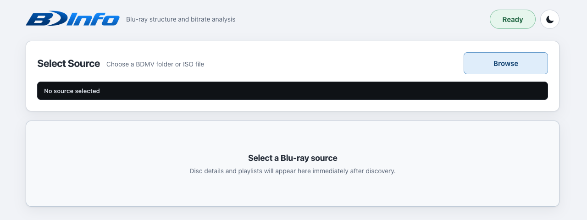
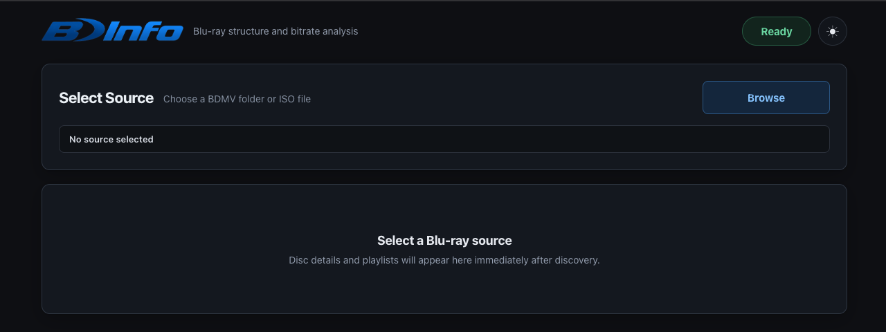
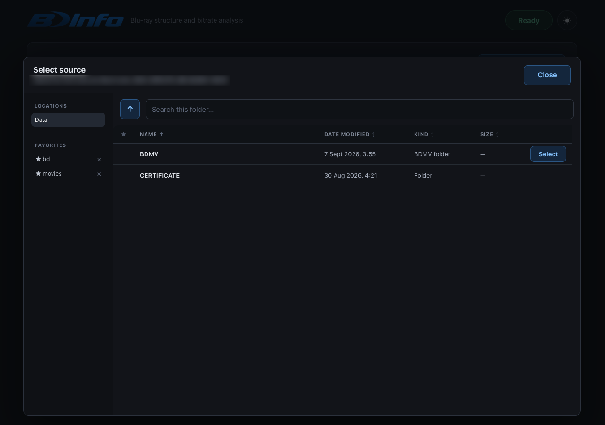
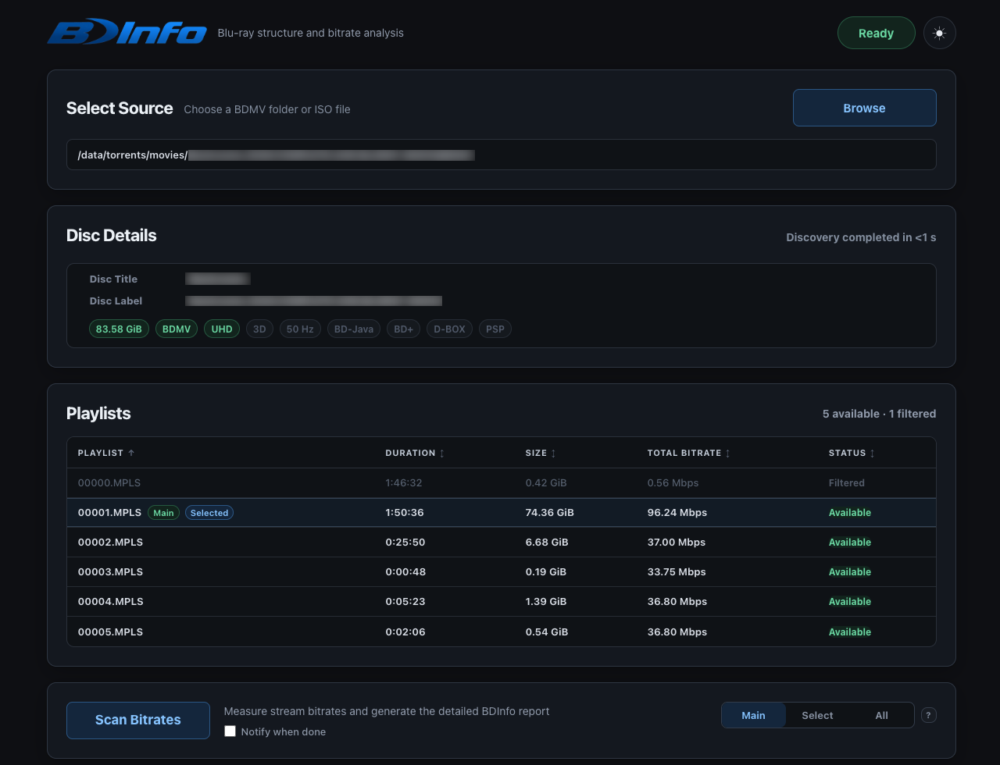
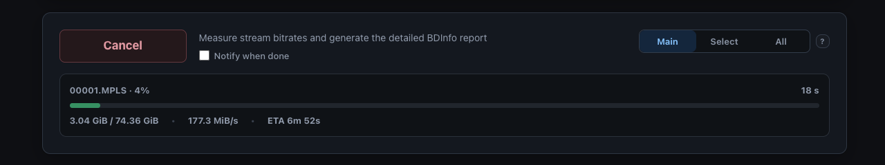
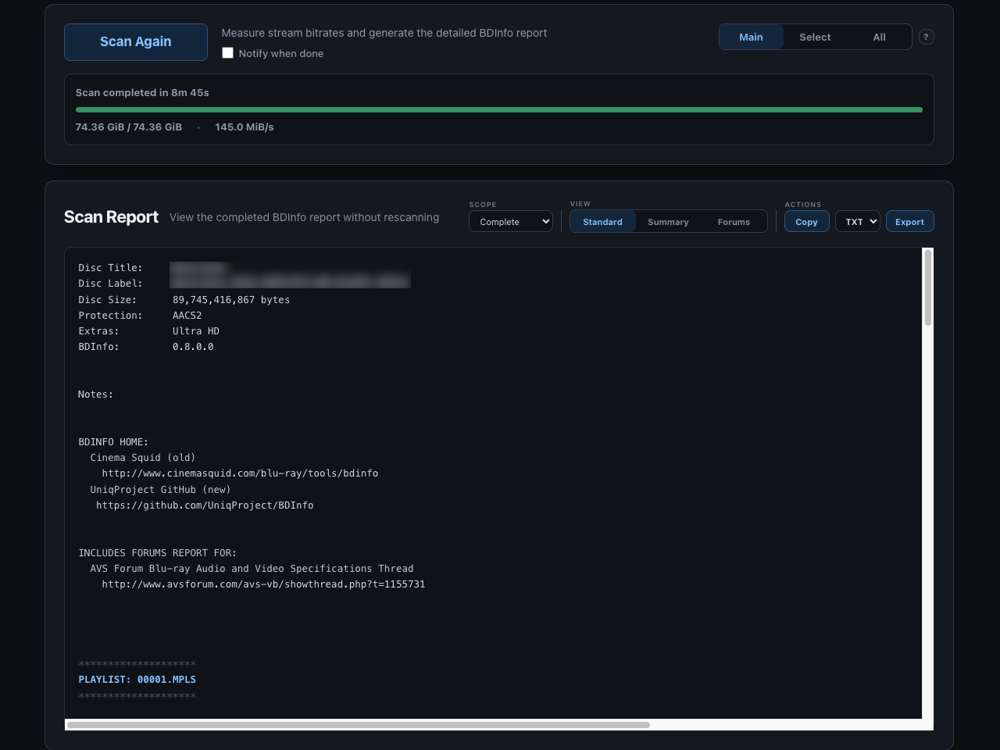
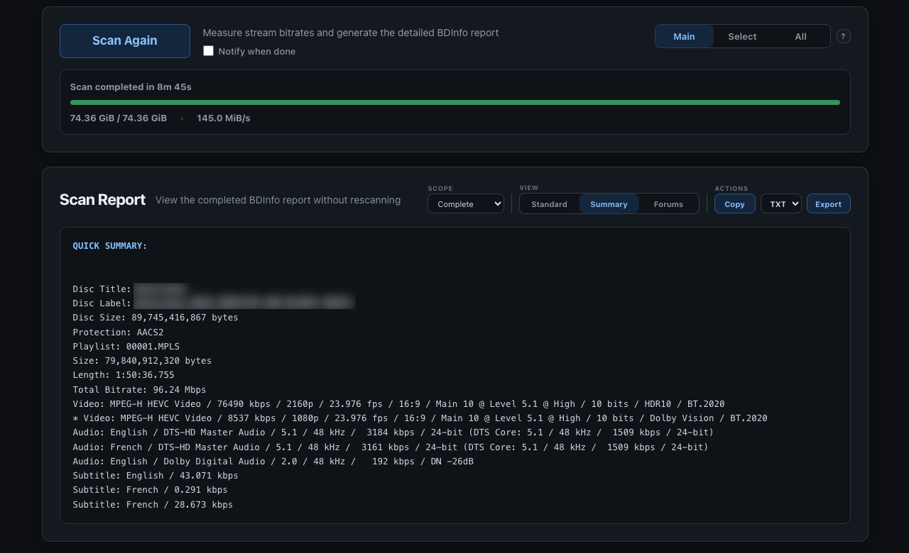

<p align="center">
  <a href="https://github.com/pegasbur/bdinfo">
    </a>
  &nbsp;&nbsp;&nbsp;&nbsp;
  <a href="https://www.unraid.net">
    </a>
  &nbsp;&nbsp;&nbsp;&nbsp;
  <a href="https://github.com/autobrr/go-bdinfo">
    </a>
</p>

<h1 align="center">BDInfo for Unraid &amp; Docker</h1>

<p align="center">
  A lightweight browser interface for Blu-ray structure and bitrate analysis,
  powered by <a href="https://github.com/autobrr/go-bdinfo">autobrr/go-bdinfo</a>.
</p>

<p align="center">
  <a href="https://github.com/pegasbur/bdinfo/actions/workflows/validate.yml"></a>
  <a href="https://github.com/users/pegasbur/packages/container/package/bdinfo"></a>
  
  
  <a href="LICENSE"></a>
</p>

<p align="center">
  <a href="https://buymeacoffee.com/pegasbur">
    
  </a>
</p>

BDInfo discovers BDMV folders and ISO images from server-side storage, identifies playlists, performs bitrate scans, and presents standard BDInfo report views in the browser.

The primary tested platform is AMD64 Unraid, but the image can also run on an AMD64 Linux Docker host.

> This is an unofficial community project. It is not maintained or endorsed by autobrr, the original BDInfo project, or Unraid.

## Contents

- [Features](#features)
- [Screenshots](#screenshots)
- [Install on Unraid](#install-on-unraid)
- [Run with Docker](#run-with-docker)
- [Docker Compose](#docker-compose)
- [Image tags](#image-tags)
- [Storage and report behavior](#storage-and-report-behavior)
- [Source-path safety](#source-path-safety)
- [Network access and security](#network-access-and-security)
- [Updating](#updating)
- [Upstream engine](#upstream-engine)
- [Copy-protected discs](#copy-protected-discs)
- [Support](#support)

## Features

- Browse Blu-ray folders and ISO files directly from the web interface
- Save frequently used media locations and favorites
- Automatically identify the main movie playlist
- Scan the main playlist, selected playlists, or the entire disc
- See live scan progress and cancel scans when needed
- View completed results in Standard, Summary, or Forums format
- See warnings and scan messages directly in the interface
- Copy reports or download them as TXT or NFO files
- Light and dark themes
- Runs entirely in your browser with no desktop application required
- Lightweight Docker container designed for Unraid and standard Docker hosts

## Screenshots

<p align="center">
  <a href="assets/screens/main-screen-light.png"></a>
  <a href="assets/screens/main-screen-dark.png"></a>
  <a href="assets/screens/source-browser-dark.png"></a>
  <a href="assets/screens/discovery-dark.png"></a>
  <a href="assets/screens/scanning-dark.png"></a>
  <a href="assets/screens/result-standard-dark.png"></a>
  <a href="assets/screens/result-summary-dark.png"></a>
</p>

<p align="center"><sub>Click any screenshot to view it full size.</sub></p>

## Install on Unraid

BDInfo is available through **Community Applications**. Search for **BDInfo** in the Apps tab and install it using the provided template.

For manual installation, the user template can still be installed from an Unraid terminal:

```bash
curl -fsSL \
  https://raw.githubusercontent.com/pegasbur/unraid-community-apps/main/templates/bdinfo.xml \
  -o /boot/config/plugins/dockerMan/templates-user/my-bdinfo.xml
```

Then open **Docker > Add Container** and select **BDInfo** from the template list.

The default address is:
```text
http://UNRAID-IP:4646
```
The host port can be changed if `4646` is already used by another container.

## Run with Docker

Prepare a writable configuration directory and a readable media directory:

```bash
mkdir -p /srv/bdinfo/config /srv/media
chown -R 99:100 /srv/bdinfo/config
```

Run the container:

```bash
docker run -d \
  --name bdinfo \
  --restart unless-stopped \
  -p 4646:4646 \
  -v /srv/bdinfo/config:/config:rw \
  -v /srv/media:/data:ro \
  ghcr.io/pegasbur/bdinfo:latest
```

The image declares `USER 99:100`; no `PUID` or `PGID` environment variables are used.

Then open:

```text
http://DOCKER-HOST-IP:4646
```

## Docker Compose

Copy the example environment file:

```bash
cp .env.example .env
```

Review the image, container name, WebUI port, configuration path, and media path in `.env`.

Start the container:

```bash
docker compose up -d
```

The supplied Compose file persists `/config` and mounts `/data` read-only.

## Image tags

| Image tag | Intended use |
|---|---|
| `ghcr.io/pegasbur/bdinfo:latest` | Current tested BDInfo wrapper release |
| `ghcr.io/pegasbur/bdinfo:0.4.2` | Current upstream application-version alias |
| `ghcr.io/pegasbur/bdinfo:0.4.2-r2` | Application and wrapper-revision tag; do not overwrite |

## Files and persistence

The principal container paths are the same on Unraid and Docker:

| Setting | Default | Container path | Access |
| --- | --- | --- | --- |
| Appdata | `/mnt/user/appdata/bdinfo` | `/config` | read/write |
| Media | `/mnt/user/data` | `/data` | read-only |

Additional host directories can be mapped when required.

## Network access and security

BDInfo has no built-in user authentication. The WebUI is intended for a trusted LAN, Tailscale, or an authenticated HTTPS reverse proxy and should not be exposed directly to the public Internet.

## Updating

### Unraid

Use Unraid's normal **Check for Updates** and **Update** controls. `/config` and `/data` mappings are preserved when the container is recreated.

### Docker

Pull the current image:

```bash
docker pull ghcr.io/pegasbur/bdinfo:latest
```

Then recreate the container with the same port and volume mappings.

Docker Compose users can run:

```bash
docker compose pull
docker compose up -d
```

## Upstream engine

The current application is pinned to:

```text
github.com/autobrr/go-bdinfo v0.4.2
```

Wrapper releases preserve exact upstream provenance in `versions.env` and image labels.

## Remark

BDInfo may not function correctly with copy-protected commercial discs. Decrypt the disc structure before analysis when required.

## Support

Report WebUI, container-image, or Unraid-template problems in this repository's [issue tracker](https://github.com/pegasbur/bdinfo/issues).

Parser and report-generation problems should be confirmed against [`autobrr/go-bdinfo`](https://github.com/autobrr/go-bdinfo) before reporting them upstream.

---

<p align="center">
  <a href="https://buymeacoffee.com/pegasbur">
    
  </a>
</p>